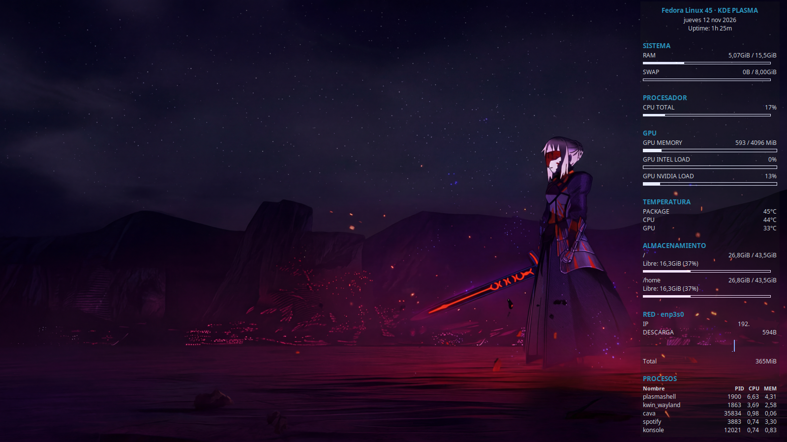

# Bosh To The Basic

**Una configuración clásica de Conky, adaptada a Linux moderno, con instalación automatizada.**

Bosh To The Basic ofrece detección de distribución, hardware y red, métricas del sistema y ajustes para KDE Plasma.

El proyecto incluye un **script de instalación automática (`install.sh`)** que prepara e instala el tema, adapta las rutas de configuración, conserva una copia de seguridad de la instalación anterior y configura el inicio automático en KDE Plasma.

La instalación es sencilla: basta con ejecutar el script incluido en el repositorio. Las dependencias del sistema deben instalarse previamente.

## Vista previa



## Estado del proyecto

- **Entorno verificado:** Fedora 45, KDE Plasma 6.8.2 y Wayland mediante Xwayland.
- **Hardware de referencia:** Intel Core i5-3330, gráficos Intel integrados
  y NVIDIA GeForce GTX 1650.
- **Otras distribuciones:** Fedora, Arch Linux y Debian, incluidas sus
  derivadas, contempladas en el diseño, pero pendientes de pruebas completas.
- **Entorno gráfico:** KDE Plasma. El posicionamiento puede variar según
  el gestor de ventanas y la sesión gráfica.

## Características

- Monitorización de CPU, RAM y SWAP.
- Temperaturas del procesador.
- Métricas de GPU Intel y NVIDIA, según hardware y herramientas disponibles.
- Información de almacenamiento.
- Detección automática de la interfaz de red.
- Dirección IP, tráfico y velocidad de descarga.
- Lista de procesos activos.
- Información de distribución Linux.
- Gráficos y recursos visuales del tema original.
- Fondo oscuro semitransparente y acento azul `#2b96c0`.
- Configuración de dimensiones y posicionamiento para varios monitores.
- Integración de inicio automático con KDE Plasma.

Las métricas que dependen de hardware o herramientas específicas pueden
no estar disponibles en todos los equipos.

## Requisitos

- Linux.
- Conky con soporte Lua, Cairo e Imlib2.
- Tipografía Noto Sans.

### Instalación de Conky

**Fedora:**

```bash
sudo dnf install conky
```

**Arch Linux, CachyOS y EndeavourOS:**

```bash
sudo pacman -S conky
```

**Debian, Ubuntu y Linux Mint:**

```bash
sudo apt install conky-all
```

Estas instrucciones indican los paquetes habituales; la disponibilidad
de los componentes Lua/Cairo debe comprobarse en cada distribución.

### Dependencias opcionales

- `lm_sensors`: información de temperaturas.
- `nvidia-smi`: métricas de GPU NVIDIA.
- `intel-gpu-tools`: métricas de GPU Intel.
- `iproute`: detección de interfaces y rutas de red.

La ausencia de una herramienta opcional puede limitar determinadas métricas,
pero no debería impedir el funcionamiento del resto del panel.

## Instalación

Desde la carpeta del proyecto:

```bash
chmod +x install.sh
./install.sh
```

El instalador:

1. Comprueba que Conky esté disponible.
2. Prepara una copia temporal del tema.
3. Sustituye las rutas internas del proyecto.
4. Conserva una copia de seguridad de la instalación anterior.
5. Instala el tema en `~/.config/conky/bosh-to-the-basic`.
6. Configura el inicio automático de KDE Plasma.

No instala dependencias del sistema automáticamente.

Para iniciar Conky manualmente:

```bash
conky -c "$HOME/.config/conky/bosh-to-the-basic/bosh-to-the-basic.conf" -d
```

## Configuración

Archivo principal:

`bosh-to-the-basic/bosh-to-the-basic.conf`

Scripts auxiliares:

`bosh-to-the-basic/scripts/`

Código Lua:

`bosh-to-the-basic/lua/`

El parámetro `xinerama_head` y las coordenadas de la ventana pueden
requerir ajustes según la cantidad, resolución y disposición de los monitores.

En sesiones Wayland, Conky puede ejecutarse mediante Xwayland.
La posición exacta de la ventana depende de KDE/KWin.

## Información de la adaptación Fedora 45

La documentación específica del entorno de referencia se encuentra en:

`bosh-to-the-basic/README-FEDORA45.txt`

Incluye detalles de hardware, sensores, almacenamiento y configuración gráfica.

## Wallpaper

El wallpaper utilizado durante el desarrollo pertenece a una fuente externa:

- Obra: Saber: Crimson Night — Fate.
- Fuente: https://wall.alphacoders.com/big.php?i=1406350
- Uso indicado por la fuente: privado y personal.

Por ese motivo, el wallpaper no forma parte de la distribución pública.
Cada usuario puede añadir su propio fondo de escritorio.

## Historia del proyecto

En 2009 ya utilizaba una configuración de Conky similar. Años después,
decidí recuperar esa estética y adaptarla a un entorno Linux moderno,
conservando el espíritu del escritorio original e incorporando nuevas
métricas, compatibilidad y ajustes para mi equipo actual.

**Una configuración clásica, adaptada al presente.**

## Créditos y licencia

Este proyecto está basado en **Hybrid Back To Basic**, una adaptación
de Conky desarrollada por **Haidir (dirn)**.

- Repositorio original:
  https://bitbucket.org/dirn-typo/back-to-basic
- Autor de Hybrid Back To Basic: Haidir (dirn).
- Versión de referencia: 1.0.1.
- Ficha original:
  https://www.gnome-look.org/p/1578329

Según el README original, el creador de la configuración Conky utilizada
como base por Haidir es desconocido.

La ficha de GNOME-Look indica GPLv3 como licencia del tema.
Antes de publicar una versión derivada, deben conservarse los avisos
de copyright y comprobarse las condiciones aplicables a cada recurso.

Los logotipos, imágenes y otros recursos de terceros pueden estar sujetos
a condiciones de uso independientes.

## Autor

**Bosh**

Proyecto personal de recuperación, adaptación y personalización de Conky para Linux.
